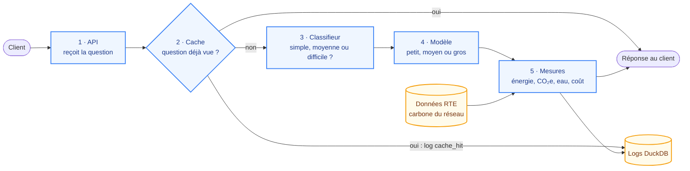

# GreenRoute · Architecture

Version 2.2 · 15 novembre 2026 · Étape C2

GreenRoute reçoit une question, choisit le modèle le plus petit qui suffit, mesure ce que la réponse coûte en énergie, CO₂e, eau et argent, et enregistre tout. `/chat` ne met jamais la requête en file d'attente : le cache répond en moins d'une seconde, les autres cas répondent dès que le modèle a fini.

## 1. Schéma



Image à exporter depuis mermaid.live : `docs/architecture.png`.

**5 modèles, 3 niveaux.** L'étape 3 choisit un niveau, l'étape 4 appelle le modèle de ce niveau. Si le modèle principal est indisponible, on essaie le repli, puis on remonte une erreur claire :

| Niveau | Modèle principal | Repli | Où |
|---|---|---|---|
| Simple | `llama3.2:3b` | `phi4-mini` | Local (Ollama) |
| Moyen | `gpt-oss:20b` | Gemini flash-lite | Local ou API |
| Difficile | Gemini flash | `gpt-oss:20b` en local ; en démo en ligne (pas de modèle local) : Gemini flash-lite. Qualité moindre, signalée dans le log | API, puis local |

La mesure du jour 5b confirme qui occupe chaque place.

## 2. Les mots à connaître

| Mot | En clair |
|---|---|
| API | La porte d'entrée du programme : c'est là qu'arrivent les questions. |
| Embedding | Une phrase transformée en liste de nombres, pour comparer les sens. |
| Cache sémantique | Une mémoire qui reconnaît les questions de même sens, pas seulement les mêmes mots. |
| Classifieur | Un petit programme de machine learning qui range une question en simple, moyenne ou difficile. |
| Token | Un morceau de mot : l'unité dans laquelle on compte ce que lit et écrit un modèle. |
| CO₂e | Les émissions de gaz à effet de serre, ramenées à un équivalent CO₂. |

## 3. Trajet d'une requête

Imagine un restaurant. Une question traverse 5 pièces, dans l'ordre du schéma :

1. **API : l'accueil.** Elle reçoit la question et refuse un message vide.
2. **Cache : la mémoire de la cuisine.** Si une question de même sens a déjà reçu une réponse, on la renvoie sans rien recalculer. C'est l'énergie la mieux économisée.
3. **Classifieur : le chef de salle.** Il juge si la question est simple, moyenne ou difficile. Si sa confiance est faible, on prend le niveau supérieur.
4. **Modèle : la cuisine.** Le petit, le moyen ou le gros modèle écrit la réponse. S'il est indisponible, on passe au repli du tableau ci-dessus.
5. **Mesures : le ticket de caisse.** On calcule l'énergie, le CO₂e, l'eau et le coût, on enregistre tout dans DuckDB et on répond.

Règles à retenir :

- **Modèle imposé.** Si la requête contient `modele`, les étapes 2 et 3 sont sautées. C'est indispensable pour le benchmark : sans ça, une réponse du cache fausserait les mesures.
- **Réponse du cache.** Elle est aussi enregistrée : `cache_hit = vrai`, tokens = 0, énergie = 0. L'énergie de calcul de l'embedding de la question est ignorée (négligeable).
- **Persistance du cache.** Le cache vit en mémoire, mais il est sauvegardé dans une table `cache` de DuckDB et rechargé au démarrage : un redémarrage ne repart pas de zéro.
- **Carbone.** Les données RTE sont celles du réseau français : valables pour les modèles locaux, une hypothèse pour Gemini. Énergie, CO₂e et eau sont des estimations, pas des mesures directes.
- **Coût.** Tout est gratuit : le coût réel est 0 €. On enregistre en plus un coût équivalent au tarif public de l'API, pour comparer les modèles.

## 4. Choix techniques

| Rôle | J'ai pris | Plutôt que | Parce que |
|---|---|---|---|
| API | FastAPI | Flask | Validation et page `/docs` automatiques |
| Logs | DuckDB | PostgreSQL | Un simple fichier, rien à installer |
| Cache | Dictionnaire en mémoire, sauvegardé dans DuckDB (table `cache`) | Redis | Gratuit, rien à héberger |
| Classifieur | Régression logistique sur embeddings | Fine-tuning d'un LLM, ou zero-shot avec BERT | Léger, rapide, quasi sans énergie à l'inférence ; cohérent avec « pas de fine-tuning » |
| Modèles | Ollama + Gemini gratuit | API payantes | Aucune carte bancaire |
| Carbone et énergie | Données RTE + CodeCarbon | Wattmètre, API payante | Gratuit (des estimations) |
| Dashboard | React + Recharts | Streamlit | Plus visible dans un portfolio |

## 5. Modules du backend

| Fichier | Rôle | Jour |
|---|---|---|
| `main.py` | Reçoit `/chat`, `/stats`, `/health` | 1 |
| `llm_api.py` | Appelle les modèles Gemini | 2 |
| `llm_local.py` | Appelle les modèles Ollama | 3 |
| `db.py` | Enregistre les logs dans DuckDB | 4 |
| `router.py` | Classifieur et choix du modèle | 9 |
| `cache.py` | Cache sémantique | 11 |
| `carbon.py` | Intensité RTE (historique et prévision 24 h), énergie, CO₂e, eau | 12 à 15 |

Il n'y a pas de `scheduler` : aucune requête n'attend dans une file.

## 6. Arborescence

```
greenroute/
├── backend/    main, llm_api, llm_local, db, router, cache, carbon
├── frontend/   dashboard React
├── data/       données RTE, embeddings, résultats de mesure
├── eval/       questions, mesure.py, embed.py, benchmark.py
├── tests/
├── docs/       00_cadrage, 01_architecture, 02_api_donnees, 03_ml_evaluation, architecture.png, maquette_dashboard.png
├── .env        jamais commité (.env.example, lui, est commité)
├── requirements.txt, Dockerfile, docker-compose.yml, README.md
```
