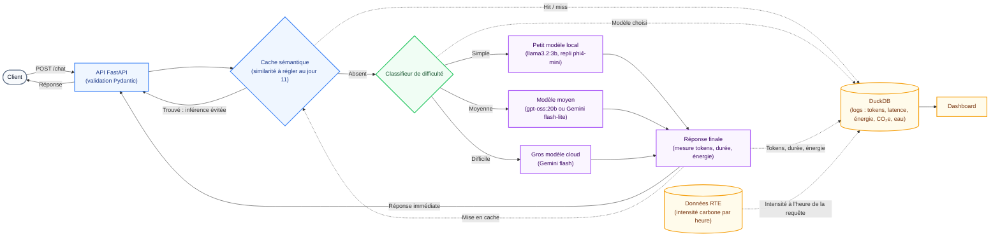

# GreenRoute · Architecture

Version 1.0 · 15 novembre 2026 · Étape C2 de la conception

GreenRoute est une API qui reçoit une question, choisit le modèle de langage le plus adapté (petit, moyen ou gros), mesure ce que la réponse coûte en énergie, en CO₂e, en eau et en argent, et enregistre tout pour le dashboard. `/chat` répond toujours immédiatement : il n'y a ni option « urgent », ni file d'attente.

## 1. Schéma global



Image du schéma : `docs/architecture.png` (exportée depuis mermaid.live).

## 2. Les mots à connaître

| Terme | Sens dans le projet |
|---|---|
| API FastAPI | Le point d'entrée du programme : la porte où arrivent les questions. |
| Cache sémantique | Une mémoire qui reconnaît les questions de même sens, pas seulement les mêmes mots. |
| Classifieur de difficulté | Un petit modèle de machine learning qui range une question en simple, moyenne ou difficile. |
| Embedding | Une question transformée en liste de nombres, pour pouvoir comparer les sens. |
| Token | Un morceau de mot : l'unité dans laquelle on compte ce que lit et écrit un modèle. |
| CO₂e | Les émissions de gaz à effet de serre, exprimées en équivalent CO₂. |

## 3. Trajet d'une requête

1. Le client envoie `POST /chat` avec un message (et, en option, un modèle imposé).
2. L'API vérifie le message avec Pydantic. S'il est vide ou mal formé, elle répond une erreur 422.
3. Le cache calcule l'embedding de la question et le compare aux questions déjà vues. Si la similarité dépasse le seuil, il renvoie la réponse mémorisée : aucun modèle n'est appelé, et la requête est journalisée avec `cache_hit = vrai`.
4. Sinon, le classifieur range la question en simple, moyenne ou difficile.
5. Le routeur choisit le modèle : petit (`llama3.2:3b`), moyen (`gpt-oss:20b` ou Gemini flash-lite) ou gros (Gemini flash). Si le modèle est indisponible, ou si la confiance du classifieur est faible, il se replie sur un autre (`phi4-mini` pour le petit, le niveau supérieur sinon).
6. Le modèle répond, via Ollama en local ou via l'API Gemini. La durée et le nombre de tokens sont mesurés.
7. Le module `carbon` calcule l'énergie (Wh), le CO₂e (énergie × intensité RTE à l'heure de la requête) et l'eau (mL). Le coût estimé est calculé au tarif public (0 € pour un modèle local).
8. La requête est enregistrée dans DuckDB, la réponse est mise en cache, puis renvoyée au client avec : la réponse, le modèle utilisé, la difficulté, `cache_hit`, le coût, le CO₂e et la latence.

Cas d'erreur : quota API atteint (erreur 429) → réessayer avec un délai croissant, puis se rabattre sur un modèle local.

## 4. Choix techniques

| Rôle | Choix | Alternative écartée | Raison |
|---|---|---|---|
| API | FastAPI | Flask | Validation Pydantic intégrée et documentation automatique sur `/docs`. |
| Logs | DuckDB | PostgreSQL | Un simple fichier local, aucun service à installer, SQL complet. |
| Cache | Dictionnaire en mémoire, sauvegardé dans DuckDB | Redis | Gratuit, aucun service à héberger. |
| Classifieur | Embeddings + régression logistique | Fine-tuning d'un LLM | Léger, rapide à entraîner, facile à expliquer. |
| Embeddings | `sentence-transformers` (modèle multilingue léger) | API d'embeddings payante | Local, gratuit, comprend le français. |
| Modèles locaux | Ollama | llama.cpp en direct | Installation simple, API HTTP locale. |
| Modèles cloud | Gemini via Google AI Studio (offre gratuite) | API payantes | Aucune carte bancaire. |
| Énergie locale | CodeCarbon | Wattmètre physique | Estimation logicielle gratuite. |
| Intensité carbone | Données RTE éco2mix | API de données payante | Open data, couvre la France. |
| Dashboard | React + Recharts | Streamlit | Plus visible dans un portfolio. |
| Déploiement | Docker + Render (offre gratuite) | Serveur payant | Gratuit, démo accessible par lien public. |

## 5. Modules du backend

| Module | Rôle |
|---|---|
| `main.py` | Crée l'API FastAPI et définit les routes `/chat`, `/stats` et `/health`. |
| `router.py` | Classe la difficulté d'une question et choisit le modèle, avec les replis. |
| `cache.py` | Calcule les embeddings, cherche une question proche et stocke les réponses. |
| `llm_api.py` | Appelle les modèles Gemini et renvoie le texte et les tokens. |
| `llm_local.py` | Appelle les modèles Ollama (`http://localhost:11434`) et renvoie le texte, les tokens et le débit. |
| `db.py` | Crée la table de logs DuckDB et y enregistre chaque requête. |
| `carbon.py` | Lit l'intensité RTE et calcule l'énergie, le CO₂e et l'eau d'une requête. |

## 6. Arborescence finale du dépôt

```
greenroute/
├── backend/
│   ├── __init__.py
│   ├── main.py
│   ├── router.py
│   ├── cache.py
│   ├── llm_api.py
│   ├── llm_local.py
│   ├── db.py
│   └── carbon.py
├── frontend/            dashboard React
├── data/                données RTE, embeddings, résultats de mesure
├── eval/
│   ├── questions_mesure.csv
│   ├── questions.csv
│   ├── mesure.py
│   ├── embed.py
│   └── benchmark.py
├── tests/
├── docs/
│   ├── 00_cadrage.md
│   ├── 01_architecture.md
│   ├── 02_api_donnees.md
│   ├── 03_ml_evaluation.md
│   └── architecture.png
├── .env                 jamais commité
├── .gitignore
├── requirements.txt
├── Dockerfile
├── docker-compose.yml
└── README.md
```
